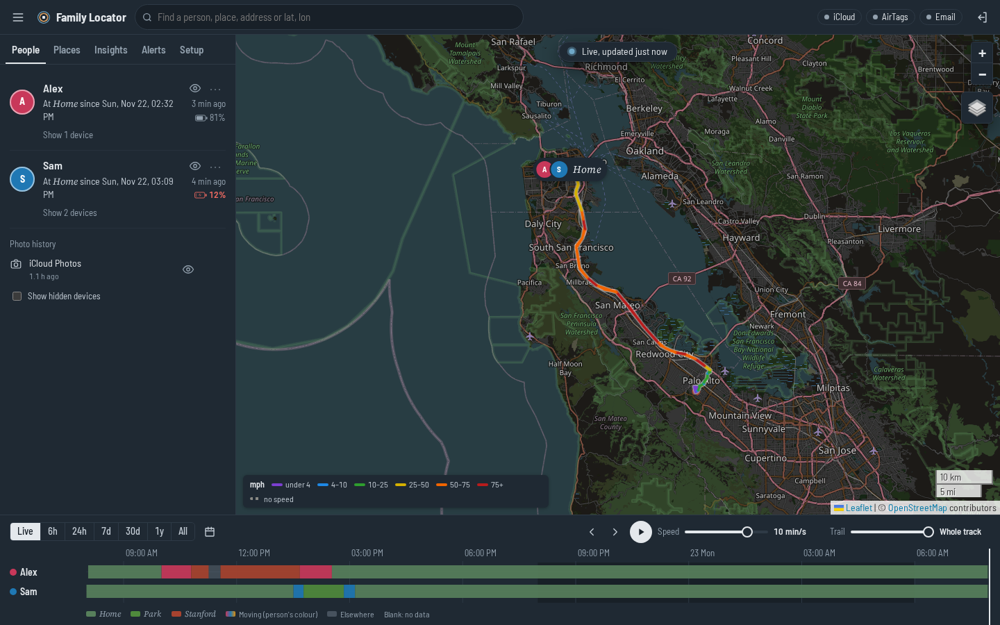
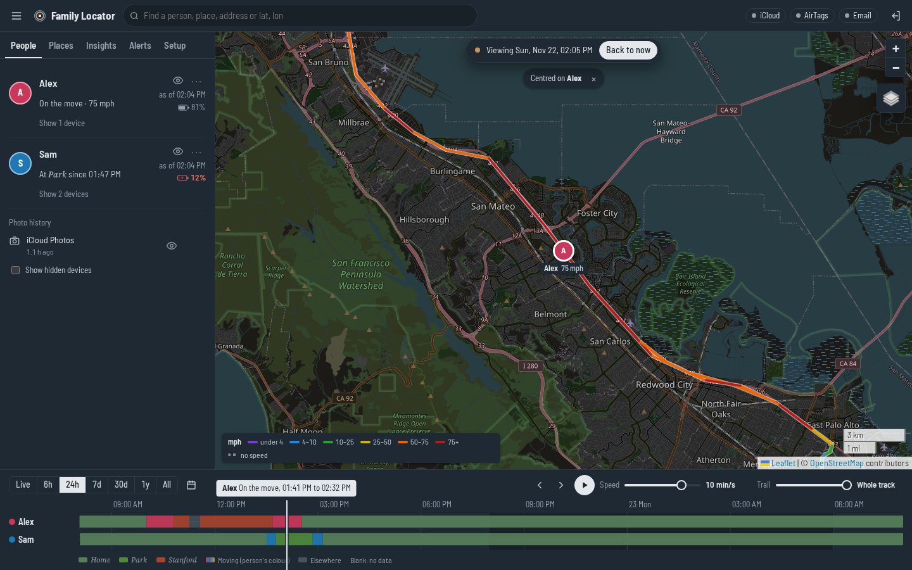
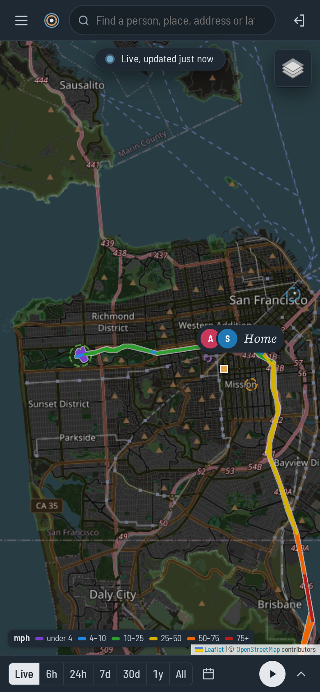
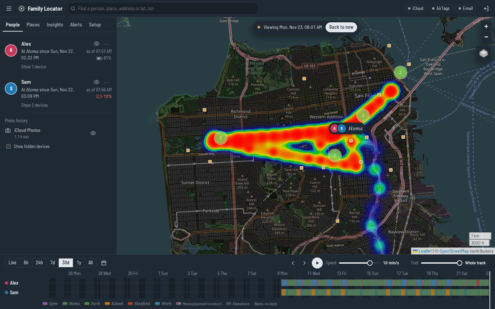
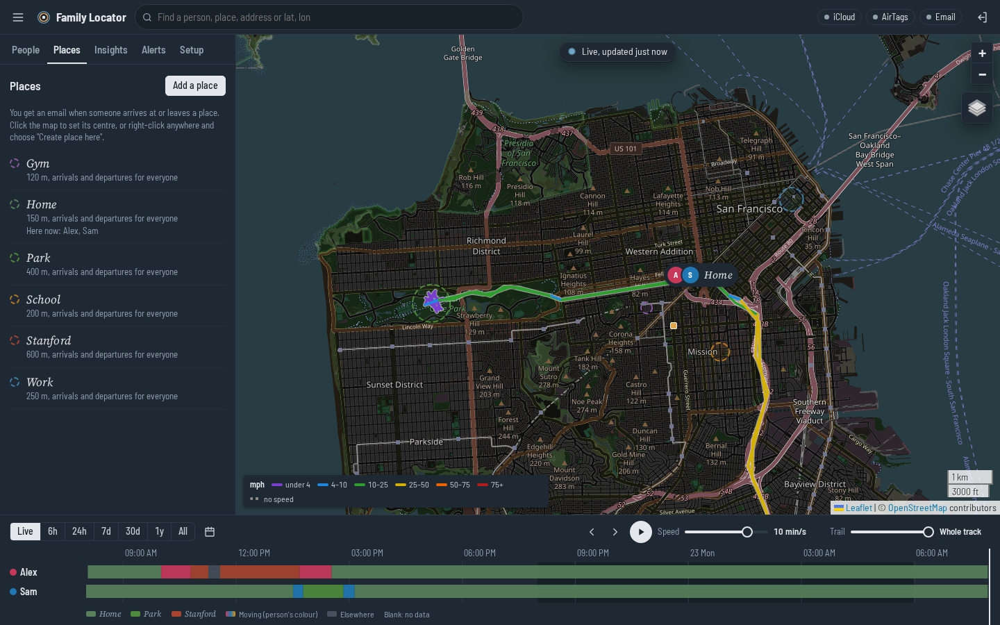

# Family Locator

Where everyone in the family is, where they've been, and an email when they arrive or leave.
Family Locator is a self-hosted app for an iCloud Family Sharing group. It keeps a history of Find
My locations, shows people on a map and a per-person timeline, and sends alerts and a daily summary.



*Screenshots use made-up demo data.*

## What it does

- **Keeps a location history Apple doesn't.** Find My only shows where a device is now. Family
  Locator checks it every few minutes and saves each new fix, so you build up a history. It survives
  restarts and has a daily backup.
- **Shows people, not devices.** Each person appears once, placed by their freshest iPhone, Watch
  or iPad fix. Their status reads like "At *School* since 08:12". Everyone at the same place shares
  one marker.
- **Timeline lanes.** One row per person, coloured by where they were. Drag the timeline to see
  any moment, or press play to watch a day go by.
- **Speed, in colour.** Tracks are coloured by speed, from purple walking to red on the freeway, and
  anyone on the move shows their average speed on their marker and in the list. Click someone and
  the map follows them.
- **Places and alerts.** Draw Home, School or Work, then get an email when someone arrives or
  leaves. You can limit a place to certain people, for example "only Sam at School".
- **Follows people while they move.** Each person has their own fresh-location interval. When
  someone sets off, the device that's actually moving is located every 2 minutes until it stops.
- **Keeps family positions fresh.** Family members' positions refresh when a new Find My session
  starts, so the app renews its session every 5 minutes (every 2 while someone travels, 10 when everyone is
  at rest) and reads every minute, within Apple's
  own limits. It never hammers.
- **Daily summary email.** Every evening: who went where, how far, and a link per person.
- **Works on a phone, from anywhere,** through the radio gateway's Cloudflare tunnel. Email links
  always carry the current address.
- **Rich map.** 12 base maps including satellite, hybrid, terrain, public transport and two dark styles, a railway overlay, zoom to
  street-entrance level, search for people, places, addresses and coordinates, and a heatmap.
- **Insights.** Distance per day, trips, stays, the places someone visits most, and battery over time.
- **Extras.** AirTag history through FindMy.py (needs keys from a Mac). Past locations backfilled
  from iCloud Photos or a photo folder.

| Playback with the timeline | On a phone |
|---|---|
|  |  |
| **Heatmap** | **Places** |
|  |  |

## Quick start

```bash
git clone https://github.com/ukbodypilot/family-locator ~/family-locator
cd ~/family-locator
./install.sh          # then open the address it prints (port 8790)
```

The installer checks for Python 3.11+, creates `.venv` and installs the packages, sets up an
owner-only `data/` folder with a starter `data/config.toml` (add Gmail details there for alerts),
and installs and starts a systemd user service. Run it again at any time; it only adds what's
missing. `./install.sh --update` pulls the latest code and restarts, `--no-service` skips the
service, and `--uninstall` removes the service but keeps your data.

On first visit you choose a password for the page. Then sign in to iCloud on the **Setup** tab
with your Apple ID and the 2FA code. Your family's devices appear within a minute. Tick
**Remember password on this computer** if you want the app to sign back in by itself when Apple
ends the session (see [Privacy and security](docs/privacy-and-security.md)). The full
walkthrough, including a manual install, is in [Getting started](docs/getting-started.md).

## Documentation

| Guide | What's in it |
|---|---|
| [Getting started](docs/getting-started.md) | Install, first sign-in, adding places, running as a service |
| [Using the app](docs/user-guide.md) | People, map, timeline, search, places, insights, every control |
| [Tracking and following](docs/tracking.md) | Per-person intervals, following people while they move, what it costs |
| [Alerts and the daily summary](docs/alerts.md) | What triggers an email, per-person rules, quiet hours |
| [Phone access](docs/phone-access.md) | Using it from anywhere through the radio gateway's tunnel |
| [AirTags and photo history](docs/airtags-and-photos.md) | FindMy.py keys, importing past locations from photos |
| [Configuration](docs/configuration.md) | Every setting, in the UI and in `data/config.toml` |
| [Privacy and security](docs/privacy-and-security.md) | What's stored, where, what leaves the machine, passwords |
| [Troubleshooting](docs/troubleshooting.md) | Common problems and how to fix them |
| [How it works](docs/architecture.md) | Modules, data model, polling, the HTTP API |

Changes are listed in [CHANGELOG.md](CHANGELOG.md).

## Requirements

- Linux with Python 3.11 or newer (developed on 3.14, Arch Linux). systemd for the service;
  without it, start the app by hand.
- An Apple ID in a Family Sharing group, with location sharing turned on by each member.
- For email: a Gmail address with an [app password](https://myaccount.google.com/apppasswords).
- For phone access from outside the home: the radio gateway with its Cloudflare tunnel (see
  [Phone access](docs/phone-access.md)), or any reverse proxy you point at port 8790.

Find My access uses the unofficial iCloud web API through
[pyicloud](https://github.com/timlaing/pyicloud). Apple can change it at any time.

Tell your family that their locations are being logged.
