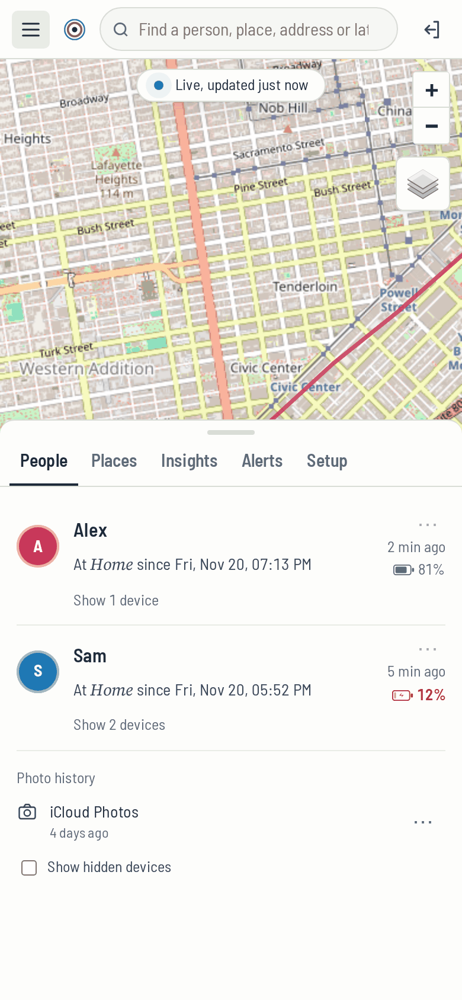

# Family Locator

Where everyone in the family is, where they've been, and an email when they arrive or leave.
Family Locator is a self-hosted app for an iCloud Family Sharing group. It keeps a history of Find
My locations, shows people on a map and a per-person timeline, and sends alerts and a daily summary.


*Screenshots use made-up demo data.*

## What it does

- **Keeps a location history Apple doesn't.** Find My only shows where a device is now. Family
  Locator checks it every few minutes and saves each new fix, so you build up a history. It survives
  restarts and has a daily backup.
- **Shows people, not devices.** Each person appears once, placed by their freshest iPhone, Watch
  or iPad fix. Their status reads like "At *School* since 08:12". Everyone at the same place shares
  one marker.
- **Timeline lanes.** One row per person, coloured by where they were. Drag the timeline to see
  any moment, or press play to watch a day go by.
- **Places and alerts.** Draw Home, School or Work, then get an email when someone arrives or
  leaves. You can limit a place to certain people, for example "only Sam at School".
- **Daily summary email.** Every evening: who went where, how far, and a link per person.
- **Works on a phone, from anywhere,** through the radio gateway's Cloudflare tunnel. Email links
  always carry the current address.
- **Rich map.** 11 base maps including satellite, hybrid, terrain and two dark styles, zoom to
  street-entrance level, search for people, places, addresses and coordinates, and a heatmap.
- **Insights.** Distance per day, trips, stays, the places someone visits most, and battery over time.
- **Extras.** AirTag history through FindMy.py (needs keys from a Mac). Past locations backfilled
  from iCloud Photos or a photo folder.

| History with the timeline | On a phone |
|---|---|
|  |  |

## Quick start

```bash
git clone https://github.com/ukbodypilot/family-locator ~/Downloads/family-locator
cd ~/Downloads/family-locator
python3 -m venv .venv && .venv/bin/pip install -r requirements.txt
mkdir -p data && cp config.example.toml data/config.toml   # add Gmail details for alerts
.venv/bin/python -m famloc.main                            # then open http://<this machine>:8790
```

On first visit you choose a password for the page. Then sign in to iCloud on the **Setup** tab
with your Apple ID and the 2FA code. Your family's devices appear within a minute. The full
walkthrough, including running it as a service, is in [Getting started](docs/getting-started.md).

## Documentation

| Guide | What's in it |
|---|---|
| [Getting started](docs/getting-started.md) | Install, first sign-in, adding places, running as a service |
| [Using the app](docs/user-guide.md) | People, map, timeline, search, places, insights, every control |
| [Alerts and the daily summary](docs/alerts.md) | What triggers an email, per-person rules, quiet hours |
| [Phone access](docs/phone-access.md) | Using it from anywhere through the radio gateway's tunnel |
| [AirTags and photo history](docs/airtags-and-photos.md) | FindMy.py keys, importing past locations from photos |
| [Configuration](docs/configuration.md) | Every setting, in the UI and in `data/config.toml` |
| [Privacy and security](docs/privacy-and-security.md) | What's stored, where, what leaves the machine, passwords |
| [Troubleshooting](docs/troubleshooting.md) | Common problems and how to fix them |
| [How it works](docs/architecture.md) | Modules, data model, polling, the HTTP API |

Changes are listed in [CHANGELOG.md](CHANGELOG.md).

## Requirements

- Python 3.11 or newer (developed on 3.14, Arch Linux).
- An Apple ID in a Family Sharing group, with location sharing turned on by each member.
- For email: a Gmail address with an [app password](https://myaccount.google.com/apppasswords).
- For phone access from outside the home: the radio gateway with its Cloudflare tunnel (see
  [Phone access](docs/phone-access.md)), or any reverse proxy you point at port 8790.

Find My access uses the unofficial iCloud web API through
[pyicloud](https://github.com/timlaing/pyicloud). Apple can change it at any time.

Tell your family that their locations are being logged.
