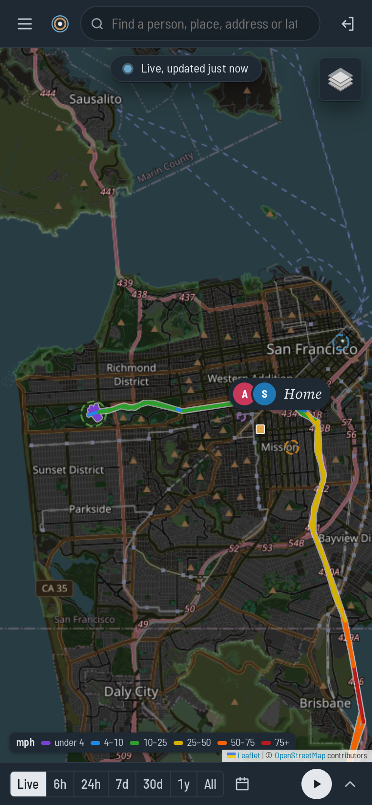
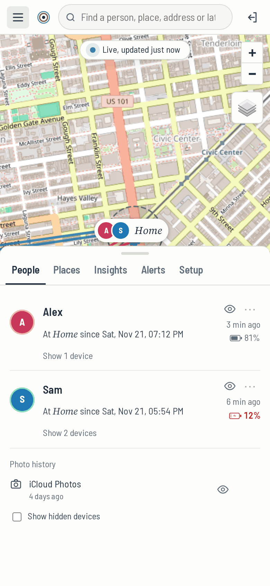

# Phone access

 

On a phone the timeline folds to one row (range and play); the arrow at its end opens the sliders and lanes. ☰ opens the people panel as a sheet.

On the home network, open `http://<machine>:8790` on any phone. From anywhere else, the app goes
through the **radio gateway**, which is already reachable from the internet over a Cloudflare tunnel.

## How it fits together

```
iPhone ──https──▶ Cloudflare ──tunnel──▶ cloudflared ──▶ radio gateway :8080 ──/family/──▶ Family Locator :8790
                                                          (gateway login)        (app login)
```

- **Tunnel:** the gateway runs `cloudflared tunnel --url http://localhost:8080`, which gives it an
  address like `https://some-words.trycloudflare.com`.
- **Proxy route:** the gateway forwards everything under `/family/` to this app.
- **Two logins:** the gateway asks for its own login first. The app then asks for its page
  password, and remembers you for 30 days.

## Getting the link

- **Setup tab:** the **Open on your phone** section shows the current link, with a **Copy** button.
- **Emails:** every alert and summary includes it as "Open (phone, anywhere)".

The quick-tunnel address **changes every time cloudflared restarts**, for example when the gateway
restarts. The app asks cloudflared for the current address (`http://127.0.0.1:20241/quicktunnel`)
whenever it builds a link, so new emails always carry the working one. A link from an older email
may stop working after a restart; use a newer email or the Setup tab.

To use a fixed address instead, such as a named Cloudflare tunnel or your own domain, set it in
`data/config.toml` and restart:

```toml
public_url = "https://family.example.com/family/"
```

## Adding to the iPhone home screen

Open the link in Safari, sign in to both prompts, then choose Share and **Add to Home Screen**.
The app's link with your session behaves like an app icon.

## What the gateway does

The route lives in the radio gateway (`handle_family_proxy` in `web_routes_get.py`, routes in
`web/handler.py`). It:

- strips the `/family` prefix and forwards to `127.0.0.1:8790`;
- passes the real client address in `X-Forwarded-For`, so the app's failed-login lockout applies
  to each visitor, not to everyone behind the proxy;
- passes cookies both ways, and allows 90 seconds for a slow **Locate now**;
- redirects `/family` to `/family/`.

`/family` and `/family/` are on the gateway's list of pages that may be opened from links on other
sites. Without that, links in Gmail would be refused as cross-site.

[User pages](user-pages.md) (`/family/v/<secret>/`) and the app's public page files
(`/family/static/`) skip the gateway login and may also be opened from an email link: the secret
in the link is the key, and the app checks and throttles it. Everything else under `/family/`
still needs the gateway login.

The gateway only handles GET and POST. The app sends its edit and delete requests as POST with an
`X-HTTP-Method-Override` header, which the app honours.

## Security

For your own page, from outside, two passwords stand in the way: the gateway's (`WEB_CONFIG_USERNAME` and
`WEB_CONFIG_PASSWORD` in `gateway_config.txt`) and the app's. The gateway's is currently `user` /
`user`, so the app's password is what really protects the location data. Use a strong one. After
5 wrong attempts from one address, logins from it are blocked for 5 minutes. Every sign-in and
failure is logged with the visitor's address:

```bash
journalctl --user-unit family-locator | grep WebAccess
```

User pages have no password at all; their link is the key. See [User pages](user-pages.md).

More in [Privacy and security](privacy-and-security.md).

## Other reverse proxies

Nothing in the app is specific to the gateway. Any proxy that forwards a path prefix (or the
whole host) to port 8790 works, because the app uses relative links throughout. Pass
`X-Forwarded-For` if you want per-visitor login throttling. That header is only trusted when the
proxy connects from the same machine.
