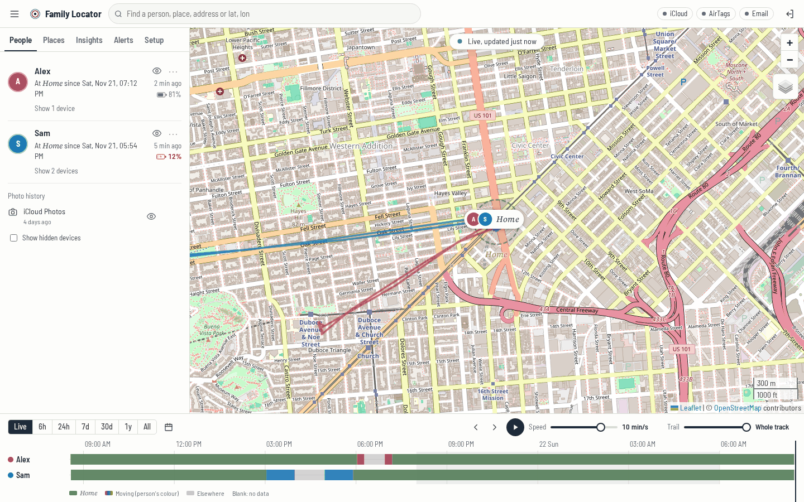
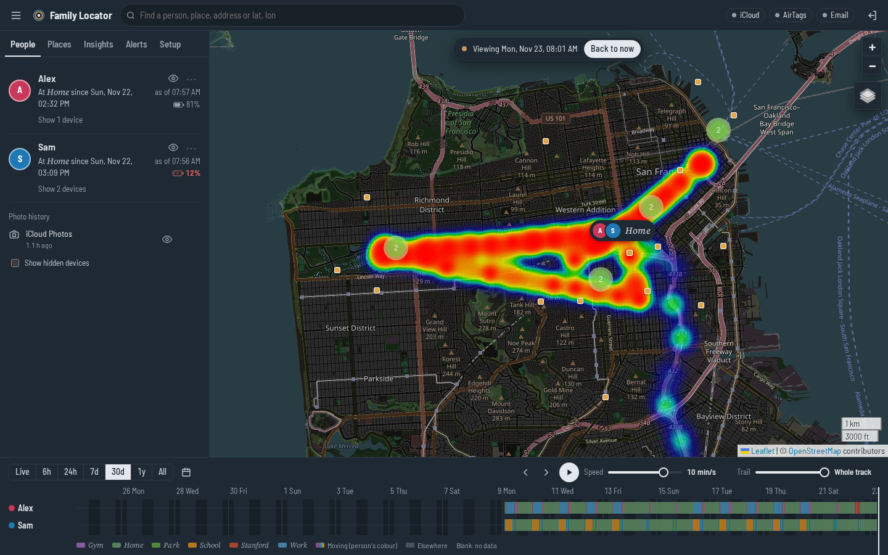
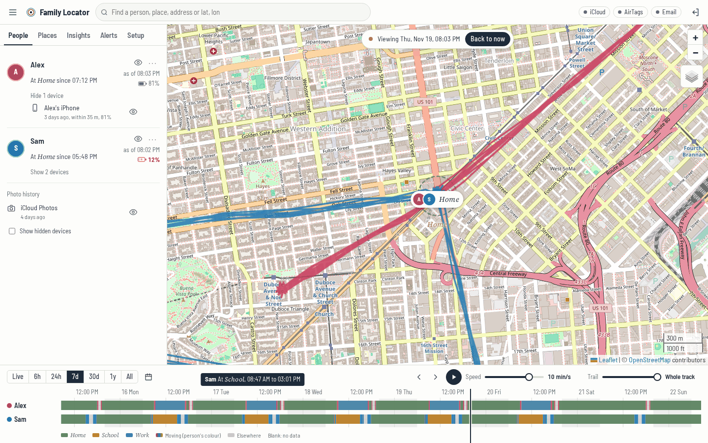
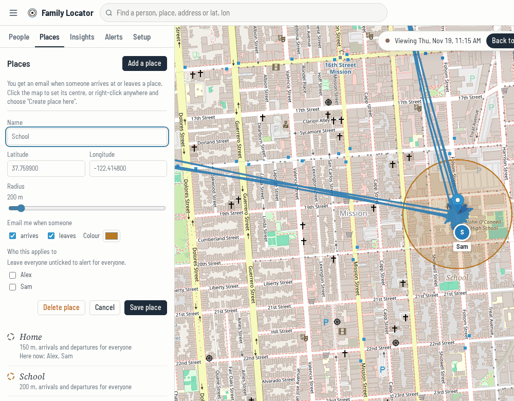
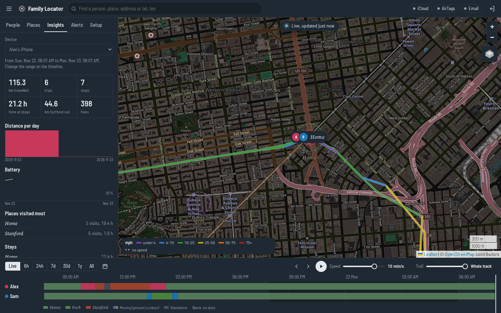
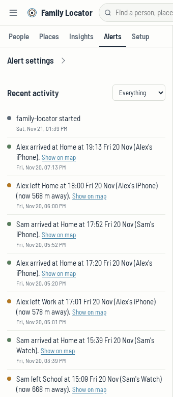

# Using the app

The screen has four parts: the **panel** on the left (a sheet at the bottom on a phone), the
**map**, the **timeline** along the bottom, and the **search bar** at the top.

## People

Each person in your Family Sharing group has a row:

- **Status.** "At *Home* since 07:13", "On the move", "Not at a saved place" or "No location yet".
  It's worked out from whichever of their phone, Watch or iPad is actually with them. When their
  devices agree, the phone is used. When they're reporting from clearly different places (more than
  300 m apart), the device that moved most recently is taken to be with the person, e.g. a Watch
  that left home rather than a phone left behind. The marker, track and timeline lane all use the
  same device.
- **How old the fix is,** and the battery of the device that reported it. A lightning bolt in the
  battery means it's charging; red means 20% or less.
- **Show devices.** Lists everything the person owns. Devices Apple has no location for, such as
  old Macs, are folded into "without a location".

Click a person to fly to them. Click their coloured circle to change their colour.

The **⋯** button on a person has:

- **Rename.** Apple's family data sometimes abbreviates names (for example "J D"). The new name is
  used everywhere, including emails. Leave it blank to go back to Apple's name, which also stays
  visible in small grey text beside the new one.
- **Change colour.**
- **Insights.**
- **Follow for 30 minutes,** or **Stop following.** Gets a fresh location from their phone every 2
  minutes, for example while they drive home. A pulsing "Following, every 2 min" appears under
  their name.
- **Tracking settings.** Jumps to their row in the tracking table on the Setup tab.

The **⋯** button on a device (shown on hover) has:

- **Locate now.** Asks just that device for a fresh fix and waits up to about 40 seconds.
- **Show last known location.** Works even for devices that are offline now, like AirPods left
  somewhere.
- **Insights and battery history.**
- **Rename** and **Hide this device.** Hidden devices drop out of the map, timeline and alerts.
  Tick **Show hidden devices** at the bottom of the list to bring them back.

**Items** (AirTags) and **Photo history** appear as separate groups below the people.

### Showing just some people on the map

The eye button next to each person shows or hides them on the map: their marker, track and
timeline lane. A person's **⋯** menu has **Show only (name) on the map**. While anyone is hidden, a
bar at the top of the list says how many are showing, with **Show all** to bring everyone back.

Devices have their own eye button (open **Show devices**). A hidden device stops being used for
the person's position, so you can, say, ignore an iPad left at home. If every device a person
carries is hidden, their row reads "Devices hidden on the map".

This is a view setting for your browser only. It doesn't change alerts, tracking or what anyone
else sees, unlike **Hide this device**, which hides a device for everyone.

## The map

- **One marker per person,** with their initials in their colour. A dashed ring means the fix is
  more than two hours old at the time you're viewing.
- **People together share a marker.** Everyone at the same saved place, or close enough that
  their markers would overlap, appears as a single pill, for example "(A)(S) *Home*". Click it to
  see who's there.
- **Click a marker** to centre the map on that person (the zoom stays) and open their details and
  actions: Locate now, Insights, What's here?, Make this a
  place, and Directions.
- **Right-click anywhere** for What's here?, Create place here, Copy coordinates and Centre the
  map here.

### Base maps and layers

The layers button (top right) picks the base map and what's drawn on it.

| Base map | Notes |
|---|---|
| Streets (OSM) | Sharp to zoom 19. |
| Dark streets (OSM) | Default (the page is dark). Sharp to zoom 19. |
| Streets (Esri) | Sharp to zoom 19. |
| Light grey, Dark grey | Quiet backgrounds. Real detail only to zoom 16, so they blur when you zoom in further. |
| Satellite, Hybrid (satellite + labels) | Sharp to zoom 19. |
| Topographic (Esri), Terrain (OpenTopoMap) | Contours and relief. |
| Cycling (CyclOSM), Humanitarian | Alternative OpenStreetMap styles. |
| Public transport (ÖPNVKarte) | Bus, tram, metro and rail routes with line numbers and stops. Real detail to zoom 18. |
| Transport (Thunderforest) | Only shown when `thunderforest_key` is set (free key from thunderforest.com). |

Every map zooms to level 22. Past a map's real detail, its last tiles are enlarged.

| Layer | What it shows |
|---|---|
| People and items | Person markers and AirTags. |
| Tracks | Each person's path, from their main device. |
| Tracks coloured by speed | On by default. Colours each track by how fast they were going: purple walking (under 5 mph), blue to 20, yellow to 55, orange to 75, red to 90, magenta above (trains, planes). Grey dashes where no speed can be trusted (more than 15 minutes between fixes). A legend sits bottom left; hover a stretch for its band. Click anywhere on a track to see the nearest fix and its accuracy circle. |
| Accuracy circles | How precise each person's fix is. |
| Every device separately | A small dot for every device, not just each person. |
| Every fix as a dot | Every saved fix in the range; click one for details and its accuracy circle. Fixes left out as outliers show as dashed grey rings. |
| Heatmap | Where people spend time. |
| Stays (from Insights) | The stays of the device open in Insights. |
| Places | Your saved places and their names. |
| Photo locations | Where photos were taken, clustered. |
| Railways (OpenRailwayMap) | Rail, metro and tram lines on top of any base map, including satellite. |

Your choices are remembered in this browser.

**Rough fixes and outliers.** A fix worse than 50 m (usually a Wi-Fi or cell-tower guess rather
than GPS) is *rough*. Rough fixes still place people on the map, but the track line only joins good
fixes: each rough one shows as a small ring of its own, so a scatter of guesses doesn't turn into
spaghetti, and they don't count towards speeds. A rough fix that is also a jump (more than 300 m
from the fixes either side of it, while those two agree, all within 15 minutes) is left out
altogether. It still shows as a dashed grey ring in the **Every fix as a dot** layer, and nothing is
deleted. Alerts are careful too: a rough fix alone never sends an "arrived" or "left" email (see
`rough_accuracy_m` in [Configuration](configuration.md)).

## The timeline

- **Ranges.** **Live** shows the last 24 hours and follows the present. The page refreshes every
  30 seconds while it's on screen, and straight away when you come back to it. **6h** to **1y** and
  **All** pick a fixed range. The calendar button sets a custom range, and the arrows step a
  whole range earlier or later.
- **Lanes.** One row per person, coloured by where they were: each saved place in its own colour,
  moving in the person's colour, grey for elsewhere, and blank where there are no fixes. Night
  hours (20:00–06:00) are shaded. Hover a lane for details such as "Sam At *School*, 08:05 to
  15:20". Click a name to fly to that person.
- **Viewing the past.** Drag the timeline to any moment. The map, people list and status lines
  all show that moment, and a banner reads "Viewing Thu 19 Nov 11:15" with **Back to now**. While
  you're viewing the past, the automatic refresh leaves you where you are.
- **Playback.** Press play to animate. The **Speed** slider sets how much time passes per second,
  anywhere from 1 second (real time) to 1 hour. The **Trail** slider sets how much track shows behind the
  cursor, anywhere from 15 minutes to 7 days. At the far right it shows the whole of the range you
  picked ("Whole range (7 days)"). Dragging it to the far right also switches the range to **All**,
  so the map shows every track you have ("All time"); pick a shorter range afterwards to keep the
  whole-range trail for just that range. Tracks are drawn up to the cursor, so drag it to the right end
  to see the newest part. Both sliders are continuous on a log scale, so the short end has as much room
  as the long end. Both are remembered in your browser.
- **Fix confidence.** The **Fixes** slider next to them sets how accurate a fix has to be to join
  the track line: from "Within 5 m" (GPS only) to "Within 2 km", and "All fixes" at the far right.
  The default is 50 m. Fixes that don't make the cut show as small rings instead, so you can still
  see them and click them. Tighten it to drop wobbly Wi-Fi and cell-tower guesses from a drive;
  loosen it to join up a trip that only had rough fixes (a train in tunnels, say). Double-click the
  slider to go back to 50 m. It only changes the drawing in your browser: speeds on the cards and
  place alerts are not affected.
- **Very long ranges.** If a range holds more than 200,000 fixes, each track is thinned evenly across
  the whole range (every track keeps its first and last fix, and photos are never dropped), and a note
  says so. Choose a shorter range to see every fix.

## A new driver in the family

Set-up for keeping an eye on a teen who has started driving:

1. **Places.** Add the places they drive to: School, Work, a friend's house, the gym. You get an
   email on every arrival and departure. A place can be limited to just them (see [Places](#places)).
2. **Tracking.** On the Setup tab, set their **Follow while moving** to **On**. Whenever their phone
   starts moving it's located every 2 minutes until it stops, so drives have a detailed track and
   an up-to-date speed. Following starts at their first fix after they set off, so also give them
   a shorter **Fresh location** (5 minutes, say) to catch the start of short trips. See
   [Tracking and following](tracking.md).
3. **Speed colours.** Keep **Tracks coloured by speed** on (it is by default). Pick **24h** or
   **7d** on the timeline and look for orange and red stretches: orange is 55–75 mph, red
   is 75–90, and magenta is over 90. Hover a stretch to see its band.
4. **Replay a trip.** Drag the timeline to the start of a drive and press play. Their marker shows
   their speed as it goes, and clicking them keeps the map centred on them.
5. **Insights.** Pick their phone for the trips list with each trip's distance and average speed.

Speeds are averaged over the last few fixes (at least 3 minutes), so a short burst of speed is
smoothed out, and a gap of more than 15 minutes shows as grey "no speed" rather than a guess. It's
a picture of how they drive, not a speed camera, and it isn't a crash detector.

## Search

Type a name, a device, a place, an address or coordinates (`37.77, -122.42`). People, devices and
places match straight away. Addresses are looked up after a short pause, or when you press Enter,
and results near the map's centre come first. Use the arrow keys and Enter, or click a result.

## Places

See [Getting started](getting-started.md#6-add-your-places) for adding places and
[Alerts](alerts.md) for what they trigger. In the place form you can:

- drag the centre marker to move the place;
- set the radius (25 m to 3 km);
- choose arrival alerts, departure alerts or both;
- pick the colour used on the map and in the timeline;
- limit the place to certain people or AirTags.

The list shows who is there now.

## Insights

Pick a device; the person's main phone is chosen by default. Insights covers the range set on the
timeline:

- **Totals:** km travelled, trips, stays, time at stays, how far from the start they went, and the
  number of fixes.
- **Charts:** distance per day and battery over time.
- **Places visited most,** **Stays** and **Trips.** Click any of them to see it on the map.
- **Name this place.** A spot visited often that isn't a saved place gets this link, which
  creates the place in one click.

A *stay* is time spent within 150 m of one spot for at least 10 minutes. Both numbers can be
changed on the Setup tab.

## Alerts tab

- **Alert settings:** quiet hours, the daily summary time, low-battery and not-reporting
  thresholds. **Preview daily summary** shows exactly what the email will say; **Email summary
  now** sends it.
- **Recent activity:** arrivals, departures, warnings and sign-in events. Each shows whether it
  was emailed. **Show on map** jumps to the person.

## Setup tab

- **iCloud Find My:** sign in or out, the status of polling, and **Locate everyone now**.
- **Open on your phone:** the current outside link and the home link.
- **User pages:** cut-down pages for relatives, each showing only the people you choose, opened
  with a secret link. See [User pages](user-pages.md).
- **Tracking:** a row per person, with **Fresh location** (Default, 1 min to 1 hour, or Never) and
  **Follow while moving** (Default, On, Off), and when their next fresh location is due. Below it
  are the global settings. See [Tracking and following](tracking.md).
- **AirTags,** **Past locations from photos,** **Email** (with **Send a test email**) and the
  **Web password.**
- At the bottom: how many fixes are stored and when the last backup ran.

## Keyboard

- **Tab:** moves through every control; the focused item is outlined.
- **Left and Right arrows on the tabs:** switch panels.
- **Arrow keys on the timeline:** step through time.
- **Escape:** closes menus and search results.
