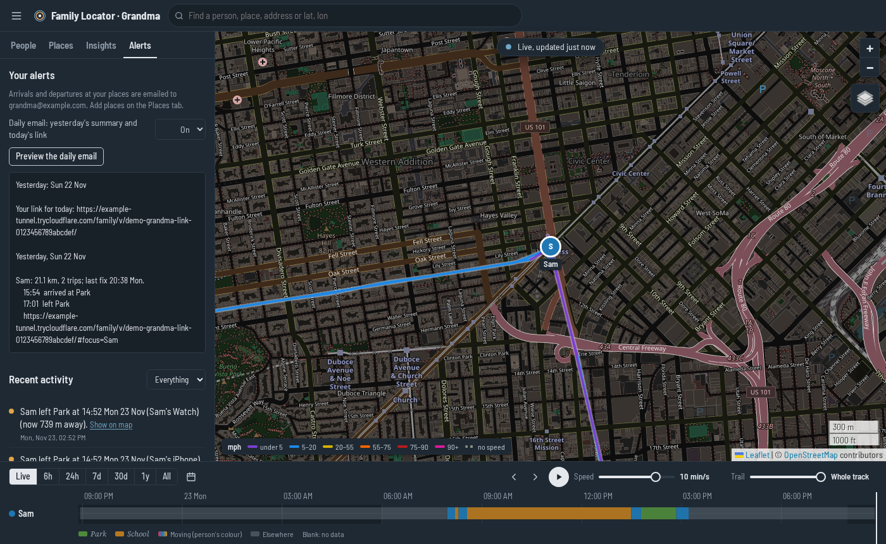
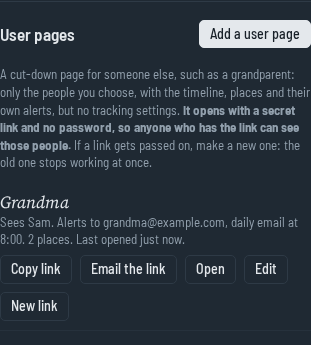

# User pages

A user page is a cut-down copy of Family Locator for someone else, such as a grandparent, an aunt or a
babysitter. It shows only the people you choose. Users can see where those people are and where
they've been, and get their own alerts. They can't see or change anything about how tracking works.



## What a user can do

- **The map, the same as yours:** markers, tracks coloured by speed, the heatmap, every base map
  and overlay, search, "What's here?", and clicking a fix to see its details and accuracy circle.
- **The timeline:** one lane per person, presets from Live to All, playback speed, the trail
  slider and the date picker. History goes back as far as yours.
- **Their own places:** they can draw places such as "Grandma's house" or "School". These belong
  to their page alone. You don't see them on your page, and they don't see yours.
- **Their own alerts:** an email when someone arrives at or leaves one of their places. It goes to
  the address you set for them, never to yours.
- **A daily email, if they want one:** a short summary of yesterday (how far each person went, their
  trips, arrivals and departures at their places) and **today's link to the page**. You choose
  whether it's on and at what hour. They can switch it off themselves on the Alerts tab.
- **Insights** for their people: distance per day, trips, stays and battery history.

## What a user can't do

- See anyone you didn't choose for their page, even by guessing a device name in the address.
- See devices you've hidden, or your photo history.
- Change tracking: no locate-now, no following, no per-person intervals, no settings.
- Rename people or devices, or change their colours.
- See or change your places, your alerts, your settings, the Apple sign-in, or the list of user pages.

The server enforces all of this, not just the page. Anything a user page isn't allowed to do is
refused.

## A page for everyone, automatically

Every family member gets their own user page showing just them, made automatically (including
anyone who joins later). Your **daily summary** lists every user page with today's link, each on its
own line, so the current links are always in your inbox:

```
User pages (today's links; each page shows only the people named):

Alex's page
    https://<tunnel>/family/v/<secret>/
Sam's page
    https://<tunnel>/family/v/<secret>/
```

Automatic pages start with no email address, so they send nothing until you add one under **Edit**.
Delete any you don't want; a deleted automatic page isn't made again.

## Making one by hand

For a page that shows several people, such as Grandma's:

1. On your page, open **Setup**, then **User pages**, and choose **Add a user page**.
2. Give it a name (it shows in their page's title), an email address for their alerts, and tick
   the people they can see.
3. Optionally turn on the daily email and pick the hour (local time, 0–23).
4. Save, then **Email the link** (or **Copy link** and send it yourself).



Each row shows who they can see, where their alerts go, how many places they've made and when the
page was last opened. **Open** shows you exactly what they see.

## The link is the key

A user page has **no password**. The link contains a long random secret, and anyone who has the
link can open the page. That's what makes it easy for a relative, and it's why you should treat the
link like a key:

- Send it only to the person it's for.
- If it gets passed on, or a phone is lost, choose **New link**. The old link stops working
  straight away; send them the new one, or let the next daily email deliver it.
- **Delete page** removes the link, their places and their alert history.

The server throttles guessing: after 10 *different* wrong links from one address in 5 minutes,
that address is refused for 5 minutes. A tab left open on an old link counts once, however often it
retries, and never affects your own page's password lockout. An old link opens a page saying it
doesn't work any more; a page left open when its link is replaced switches to that message. Every visit to a user page is logged at most once an hour per page, and every
wrong link is logged too, both as `[WebAccess]` lines:
`journalctl --user-unit family-locator | grep WebAccess`.

## Links from outside the house

User pages are reached the same way as your page from outside: through the radio gateway's
Cloudflare tunnel, at `https://<tunnel>/family/v/<secret>/`. The gateway skips its own login for
these paths (and for the app's public page files), because the secret link is the key. Every other
path, including your own page, still needs the gateway login. See [Phone access](phone-access.md).

The tunnel's address **changes whenever the tunnel restarts**, and that breaks a saved link. This is
what the daily email is for: it always carries the current address. With the daily email off, use
**Email the link** after a tunnel restart. On the home network the page also works at
`http://<this machine>:8790/v/<secret>/`; **Copy link** gives that address when the tunnel is down.

## Details

- **Alerts:** a user's places use the same rules as yours. A fix must be accurate enough, rough
  fixes are confirmed first, there's one email per person when phone and watch cross together,
  and no late duplicate from a device that was asleep. Your quiet hours don't apply to their alerts.
- **Email:** user emails go out through the same account as yours (`email_address` and
  `email_app_password` in `data/config.toml`). They contain only that user's own link, never yours.
- **Summary period:** the daily email covers the whole of the previous day, midnight to midnight,
  whatever hour it's sent.
